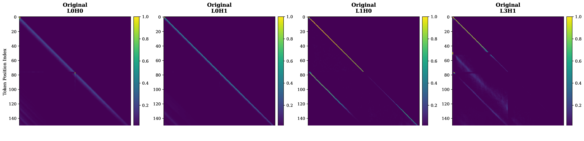
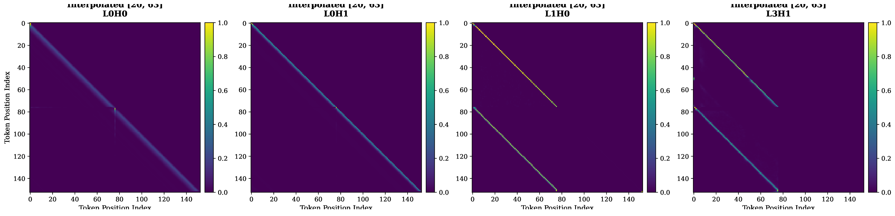

<!-- ============ HERO ============ -->
<section class="scb-hero">
  <canvas id="scb-hero-canvas"></canvas>
  

    DeLTa Workshop &middot; ICLR 2026
    <h1>Sliding Critical Band</h1>
    
A hidden band of RoPE frequencies decides whether a language model collapses past its training length &mdash; and that band isn't fixed. It <em>slides</em>.

    
Zifei Bai &amp; Zhiwei Xu

    

      <a class="scb-btn primary" href="https://openreview.net/forum?id=y2IeQSTxmc" target="_blank" rel="noopener">Read the Paper</a>
      <a class="scb-btn ghost" href="https://github.com/zifei-bai/Sliding-Critical-Band-in-RoPE-based-Length-Extrapolation" target="_blank" rel="noopener">View Code</a>
    

  

  
Scroll

</section>

<!-- ============ 1. THE PROBLEM ============ -->
<section>
  

    

      

        
The Problem

        <h2 class="scb-h2">LLMs are great at their training length. Then they fall apart.</h2>
        
Rotary Positional Encoding (RoPE) tells a transformer where a token sits by <strong>rotating</strong> its query/key vector. Split the vector into pairs \((x_1,x_2), (x_3,x_4), \ldots\) and spin the \(i\)-th pair by angle \(m\theta_i\), where \(m\) is the token's position and \(\theta_i = \theta^{-2i/d}\) shrinks fast as \(i\) grows.

        
Drag the slider below: low-<code>i</code> pairs (left) whirl around many times as \(m\) increases; high-<code>i</code> pairs (right) barely twitch. Push \(m\) past anything seen in training and some of these rotations land on angles the model has never encountered &mdash; performance falls off a cliff.

      

      

        

          
Token position m = 12

          <input type="range" min="0" max="100000" value="12" step="0.5" class="scb-compare-slider" id="scb-rope-m-slider" aria-label="Token position m">
          

        

        
Each dial is one real rotary subspace \( i \in \{0,16,32,48,64,95\} \), rotated by the actual \( m\theta_i \) &mdash; not a decorative loop.

      

    

    

      

        <h3 class="scb-h3" style="margin-top:0;">Why rotating encodes relative position</h3>
        
Two copies of the same token at two different positions rotate to different absolute angles &mdash; but the <strong>angle between them</strong> depends only on the distance apart, \( (m_B - m_A)\theta \). That's the whole trick behind RoPE.

        

          <canvas id="scb-rel-canvas" width="280" height="280"></canvas>
          

            <label>Token A position mA = 0
              <input type="range" min="0" max="40" value="0" step="0.5" class="scb-compare-slider" id="scb-rel-ma-slider">
            </label>
            <label>Token B position mB = 18
              <input type="range" min="0" max="40" value="18" step="0.5" class="scb-compare-slider" id="scb-rel-mb-slider">
            </label>
            

              

&mdash;

&Delta;angle = (mB &minus; mA) &middot; &theta;

            

            
Try moving <strong>both</strong> sliders by the same amount &mdash; the angle between A and B never changes.

          

        

      

    

  

</section>

<!-- ============ 2. OLD THEORY VS TWIST ============ -->
<section class="scb-alt">
  

    

      
The Prevailing Theory

      <h2 class="scb-h2">"Just fix the low frequencies," they said.</h2>
      
The standard explanation says failure comes from <strong>low-frequency</strong> dimensions rotating past a fixed <strong>critical dimension</strong> \( d_{\text{extra}} \) into out-of-distribution angles they never saw in training:

      
\[ d_{\text{extra}} = \left\lceil \frac{d_{\max}}{2}\,\log_{\theta}\!\left(\frac{L_{\text{train}}}{2\pi}\right) \right\rceil \]

      
For a 100-digit copying task, that threshold lands at <code>d_extra = 37</code>. If the theory were right, the model should only need help below that point &mdash; and everything above it should be free to roam.

      
We tested that directly by interpolating only a chosen range of dimensions and sweeping where that range starts. The result didn't match the theory.

    

    

      

        

        

        
Each marker is a real measurement from the paper: the empirically-best cutoff <code>d_upper</code> (green) and the perplexity exactly at the theoretical threshold <code>d_extra = 37</code> (grey), for the 100-digit task. Notice <code>d_upper</code> sits <strong>before</strong> the dashed line &mdash; the textbook boundary is already too permissive at mild extrapolation ratios.

      

    

  

</section>

<!-- ============ 3. FORMALIZING THE BAND ============ -->
<section>
  

    

      
Reframing It

      <h2 class="scb-h2">Three zones, not one boundary</h2>
      
Sweeping the interpolation range from both directions reveals two boundaries, not one: an <strong>upper bound</strong> where the optimal cutoff sits, and a <strong>lower bound</strong> past which more interpolation stops helping. Together they carve the spectrum into three functional regions:

    

    

      

        

          

          

          

        

        
024487295

        

          <strong>Harmful [0, 20)</strong>&nbsp;&mdash; carries local structure; interpolating it confuses nearby tokens
          <strong>Critical Band [20, 68]</strong>&nbsp;&mdash; must be interpolated to survive extrapolation
          <strong>Benign (68, 95]</strong>&nbsp;&mdash; interpolating it is basically a no-op
        

        
Shown for the 100-digit task at extrapolation ratio <code>s = 1.2</code>, matching the paper's empirical boundaries.

      

    

  

</section>

<!-- ============ 4. THE SLIDING BAND (HERO WIDGET) ============ -->
<section class="scb-alt scb-pin-stage" id="scb-slide-section">
  

    

      
The Core Finding

      <h2 class="scb-h2">The band doesn't sit still &mdash; it slides.</h2>
      
As the extrapolation ratio \( s = L' / L_{\text{train}} \) grows, both boundaries migrate toward the low-frequency end of the spectrum. The "right" dimensions to interpolate at \( s = 1.2 \) are the wrong ones at \( s = 8 \).

    

    

      

        

          Task length
          

        

        

          Extrapolation ratio s
          

        

        

          

          

          

        

        

        

          

&mdash;

d upper

          

&mdash;

d lower

          

&mdash;

band width

        

        
Values are the real upper/lower bounds reported in the paper (Table 2) for 50/100/500-digit string-copying tasks across six extrapolation ratios.

      

    

  

</section>

<!-- ============ 5. BANDWIDTH EXHAUSTION ============ -->
<section>
  

    

      
Why Bigger RoPE-Base Helps

      <h2 class="scb-h2">Spectrum Bandwidth Exhaustion</h2>
      
Push \( s \) high enough and the lower bound eventually runs past the last available dimension &mdash; the spectrum simply runs out of room, and the model collapses outright. Raising the RoPE base \( \theta \) lowers the frequency floor, which <strong>buys the band more room to slide</strong> before that happens.

    

    

      

        

          RoPE base &theta;
          

        

        

          Extrapolation ratio s
          

        

        

          

          

          

        

        
024487295

        

          

PPL, s=2

&mdash;

          

PPL, s=4

&mdash;

          

PPL, s=8

&mdash;

        

        
500-digit task. Switch &theta; from <code>1e4</code> to <code>1e5</code> and watch the band pull back inside the spectrum, with perplexity dropping accordingly (e.g. at <code>s = 8</code>: 3.20 &rarr; 2.00).

      

    

  

</section>

<!-- ============ 6. ATTENTION RECOVERY ============ -->
<section class="scb-alt">
  

    

      
What It Looks Like Inside the Model

      <h2 class="scb-h2">The slash pattern comes back</h2>
      
Long-context attention heads often develop a clean diagonal "slash" &mdash; attending to tokens a fixed relative distance back. Under extrapolation that slash blurs and breaks apart. Interpolating exactly the Critical Band restores it.

    

    

      

        Original RoPE
        Critical Band interpolated
        
        

      

      <input type="range" min="0" max="100" value="50" class="scb-compare-slider" id="scb-fig5-slider" aria-label="Drag to compare original vs interpolated attention patterns">
      
Four attention heads (L0H0, L0H1, L1H0, L3H1) on the 100-digit task at <code>s = 1.5</code>. Drag the slider &mdash; the interpolated row (right) keeps its diagonal slash sharp all the way to the sequence end; the original (left) fades and fragments past the training length.

    

  

</section>

<!-- ============ 7. REAL WORLD VALIDATION ============ -->
<section>
  

    

      
Beyond Toy Models

      <h2 class="scb-h2">Same sliding dynamics on LLaMA-7B + C4</h2>
      
The synthetic string-copying task is a controlled lens, so we re-ran the same boundary search on real LLaMA-7B weights over the C4 English corpus.

    

    

      

        

          Extrapolation ratio s
          

        

        

          

          

          

        

        
016324863

        
LLaMA-7B head dimension is 128 (64 rotary subspaces). Band positions for <code>s = 1.125, 1.25, 2.0</code> are exact values from the paper; <code>s = 1.75</code> is a visual interpolation between the two neighboring measured ratios (not separately reported).

      

    

    

      <h3 class="scb-h3">Zero-shot perplexity at extended context (C4)</h3>
      
Sliding Critical Band (SCB) needs <em>no fine-tuning</em> to match or beat Position Interpolation and YaRN &mdash; it's already the model's intrinsic mechanism, just correctly targeted.

      

      

        
Show full results table (all ratios, ZS &amp; fine-tuned)

        

      

    

  

</section>

<!-- ============ 8. CTA ============ -->
<section class="scb-final">
  

    

      <h2 class="scb-h2">Not a fixed boundary. A moving target.</h2>
      
Sliding Critical Band reframes RoPE extrapolation failure as a dynamic, trackable phenomenon &mdash; and Spectrum Bandwidth Exhaustion explains the hard physical limit underneath it. Both point toward position encodings that track their own frequency boundaries in real time.

      

        <a class="scb-btn primary" href="https://openreview.net/forum?id=y2IeQSTxmc" target="_blank" rel="noopener">Read the Paper</a>
        <a class="scb-btn ghost" href="https://github.com/zifei-bai/Sliding-Critical-Band-in-RoPE-based-Length-Extrapolation" target="_blank" rel="noopener">View Code</a>
      

      
@inproceedings{bai2026sliding,
  title     = {Sliding Critical Band in RoPE-based Length Extrapolation},
  author    = {Bai, Zifei and Xu, Zhiwei},
  booktitle = {DeLTa Workshop @ ICLR 2026},
  year      = {2026},
  url       = {https://openreview.net/forum?id=y2IeQSTxmc}
}

      <a class="scb-back" href="/">&larr; Back to zifei-bai.github.io</a>
    

  

</section>

