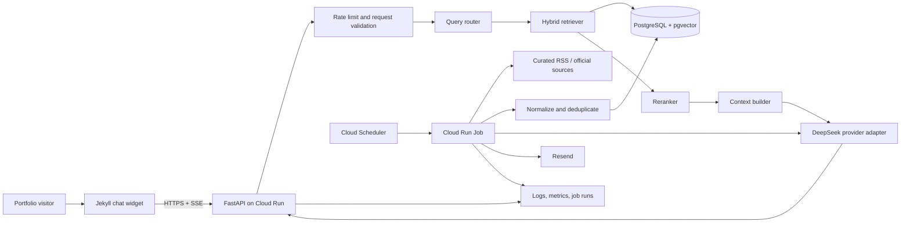
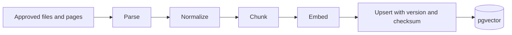
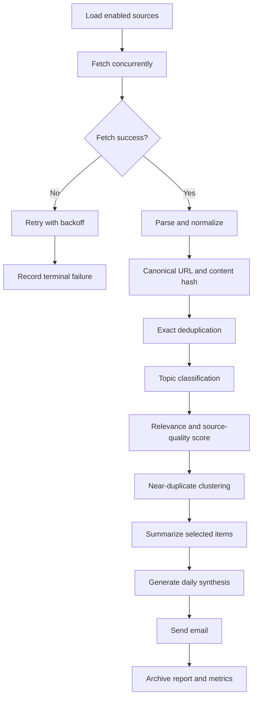
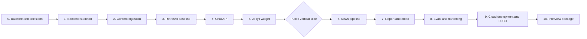

# Personal Intelligence Agent：产品与实施计划

> Working title: **SignalDesk**  
> Document status: Draft v0.1  
> MVP language: English only  
> Target roles: LLM Application Engineer / Agent Engineer  
> Time budget: 10–15 hours per week

## 1. Executive summary

SignalDesk is a personal knowledge and AI intelligence system embedded in a portfolio website. It has two connected capabilities:

1. A public Personal Agent that answers questions about the owner's experience, projects, skills, and technical decisions with source citations.
2. A private AI News workflow that collects trusted AI news, removes duplicates, ranks items by personal relevance, produces a daily report, sends it by email, and archives the report for later retrieval.

The two capabilities share one knowledge platform. Personal documents tell the news workflow which topics matter; news and archived reports let the Personal Agent answer time-sensitive questions such as “What AI agent developments are most relevant to your work this month?”

The project is intentionally not a fully autonomous multi-agent system. Most steps are deterministic software workflows. LLM calls are used only where semantic judgment or language generation provides clear value.

## 2. Product problem

### 2.1 User problem

A traditional portfolio is static. Recruiters must read multiple pages to understand a candidate, while project descriptions rarely demonstrate how the candidate builds reliable LLM applications.

AI news consumption has the opposite problem: too much changing information, repeated articles, weak personalization, and little connection to the reader's existing projects or career goals.

### 2.2 Product opportunity

One system can solve both problems:

- Let visitors explore the portfolio conversationally.
- Ground every factual answer in owner-approved sources.
- Continuously collect relevant AI developments.
- Explain why each development matters to the owner's interests and projects.
- Turn daily reports into a time-aware knowledge archive.

### 2.3 Product thesis

The strongest version of a “personal agent” is not a chatbot that imitates a person. It is a trustworthy interface over approved personal knowledge plus a continuously updated intelligence archive.

## 3. Users and jobs to be done

### 3.1 Recruiter or hiring manager

**Job:** Quickly understand whether the candidate has relevant experience.

Example questions:

- “What production experience does Zifei have with Python?”
- “Which projects demonstrate RAG or agent engineering?”
- “What trade-offs did he make in this project?”
- “Which recent AI developments relate to his work?”

### 3.2 Technical interviewer

**Job:** Evaluate whether the candidate understands the system rather than merely assembling APIs.

Expected evidence:

- Architecture and design decisions
- Retrieval and generation evaluation
- Failure handling and observability
- Security and prompt-injection defenses
- Cost, latency, and quality trade-offs

### 3.3 Owner / administrator

**Job:** Maintain personal content, receive a useful daily report, inspect failures, and control cost.

## 4. Goals, non-goals, and constraints

### 4.1 MVP goals

- Answer English questions about approved portfolio content.
- Include clickable citations for factual claims.
- Refuse or qualify answers when evidence is insufficient.
- Stream responses into the existing Jekyll website.
- Ingest AI news from a curated source list once per day.
- Deduplicate, rank, summarize, email, and archive a daily report.
- Record latency, token usage, cost estimate, retrieval results, and errors.
- Stay below a target infrastructure and model budget of USD 10 per month at portfolio traffic.

### 4.2 Non-goals for the first release

- Chinese-language UX or cross-language retrieval
- Voice, avatars, or realtime audio
- Fine-tuning a model
- Autonomous browsing of arbitrary websites
- Automatically posting to social media
- Letting public users invoke write actions
- Kubernetes or microservice decomposition
- Long-term personal memory about anonymous visitors

### 4.3 Constraints

- Existing frontend is GitHub Pages with Jekyll.
- Python is the primary implementation language.
- TypeScript/JavaScript is limited to the website widget.
- DeepSeek is the default generation provider.
- Backend deploys as a container on Google Cloud Run.
- PostgreSQL with pgvector is the system of record.

## 5. Success metrics

### 5.1 Product metrics

| Metric | MVP target | Why it matters |
|---|---:|---|
| Successful chat completion rate | >= 95% | Basic reliability |
| Answers with at least one valid citation when evidence exists | >= 95% | Trust |
| Positive feedback rate | Establish baseline | User usefulness |
| Unanswered-question capture rate | 100% | Reveals content gaps |
| Daily report delivery success | >= 95% over 30 days | Workflow reliability |

### 5.2 AI quality metrics

| Metric | MVP target | Measurement |
|---|---:|---|
| Retrieval Recall@5 | >= 0.85 | Golden question set |
| Citation precision | >= 0.90 | Human-labeled claim/source pairs |
| Grounded answer rate | >= 0.85 | Rubric-based evaluator plus spot checks |
| Correct refusal rate | >= 0.90 | Unanswerable test questions |
| News duplicate rate | < 5% | Canonical URL and semantic duplicate audit |

### 5.3 Operational metrics

| Metric | MVP target |
|---|---:|
| Warm P95 time to first token | < 3 seconds |
| Cold-start response | < 10 seconds |
| Public API 5xx rate | < 1% |
| Monthly combined operating cost | < USD 10 |
| Secret exposure incidents | 0 |

Targets are initial engineering hypotheses. They should be revised after baseline measurements rather than treated as guaranteed service-level objectives.

## 6. User journeys

### 6.1 Public chat journey

1. Visitor opens the portfolio.
2. Visitor opens “Ask my AI assistant”.
3. Widget shows example questions and a disclosure that answers are AI-generated from approved sources.
4. Visitor asks an English question.
5. System retrieves relevant personal or news evidence.
6. System streams a grounded response.
7. Widget displays citations and feedback controls.
8. If evidence is insufficient, the assistant says so and suggests a related answerable question.

### 6.2 Daily intelligence journey

1. Scheduled job loads the curated source registry.
2. It fetches RSS/API content and normalizes metadata.
3. It removes exact and near duplicates.
4. It classifies and ranks items against configured interests.
5. It summarizes selected articles with citations.
6. It creates and emails a daily report.
7. It archives the report and source links in the shared knowledge base.
8. The owner can later ask the public agent about trends in the archive.

## 7. System architecture



### 7.1 Repository boundaries

**`zifei-bai.github.io`**

- Jekyll layout integration
- Chat widget markup, styles, and client logic
- Public configuration such as API base URL
- No model, database, or email secrets

**`personal-intelligence-agent`**

- FastAPI service
- Ingestion and news pipelines
- Model and embedding providers
- Database migrations
- Evaluation datasets and runners
- Tests, Docker, CI/CD, and infrastructure configuration

### 7.2 Why this is not a microservice system

The API and scheduled job can share one Python package and one container image while deploying as separate Cloud Run workloads. This preserves clear runtime boundaries without paying the organizational and operational cost of multiple independent services.

## 8. Core technical design

### 8.1 Provider abstraction

Business logic must not call DeepSeek directly. It depends on an internal interface:

```python
class LLMProvider(Protocol):
    async def generate(self, request: LLMRequest) -> LLMResponse: ...
    async def stream(self, request: LLMRequest) -> AsyncIterator[LLMEvent]: ...
```

Initial implementations:

- `DeepSeekProvider`: production default
- `FakeProvider`: deterministic unit tests
- Optional comparison provider: offline evaluation only

The provider returns normalized usage, latency, finish reason, model version, and error information.

### 8.2 Personal content ingestion



Implementation rules:

- Maintain an explicit allowlist of approved sources.
- Preserve document title, URL, section heading, source type, timestamps, and checksum.
- Prefer structure-aware chunks over fixed character splitting.
- Use deterministic document and chunk IDs so re-ingestion is idempotent.
- Delete or deactivate stale chunks when a source version changes.
- Store enough provenance to reconstruct every citation.

### 8.3 Online RAG flow

1. Validate length and normalize the question.
2. Reject abuse and enforce per-IP/session quotas.
3. Route to `personal`, `news`, `hybrid`, or `unsupported`.
4. Run vector retrieval plus PostgreSQL full-text retrieval.
5. Merge results with reciprocal-rank fusion or a documented baseline.
6. Apply metadata filters and optional reranking.
7. Build a token-budgeted evidence context.
8. Ask the LLM to answer only from evidence and emit citation identifiers.
9. Stream user-visible text while retaining structured metadata server-side.
10. Validate citation identifiers before returning the final event.
11. Record retrieval, model usage, latency, and feedback correlation IDs.

### 8.4 News workflow



The job is deterministic around LLM calls. Retrying a job must not create duplicate articles, reports, or emails.

### 8.5 Data model

| Table | Responsibility | Important constraints |
|---|---|---|
| `documents` | Approved personal/news/report sources | Unique stable source ID and version |
| `chunks` | Searchable document sections | Unique `(document_id, chunk_index, version)` |
| `news_articles` | Normalized news metadata | Unique canonical URL and content hash |
| `daily_reports` | Generated report artifact | Unique report date and edition |
| `report_articles` | Report-to-article relation | Unique pair |
| `chat_sessions` | Anonymous session metadata | Expiration timestamp |
| `chat_messages` | Optional minimal conversation log | Retention policy and redaction |
| `feedback` | Helpful/unhelpful signals | Request correlation ID |
| `llm_calls` | Usage, latency, model, cost estimate | Never store secrets |
| `job_runs` | Workflow state and checkpoints | Idempotency key and status |
| `failed_items` | Terminal ingestion failures | Retry count and error category |

### 8.6 API surface

| Method | Endpoint | Purpose |
|---|---|---|
| `GET` | `/health/live` | Process health |
| `GET` | `/health/ready` | Dependency readiness |
| `POST` | `/v1/chat/stream` | SSE chat response |
| `POST` | `/v1/feedback` | Record response feedback |
| `POST` | `/internal/ingest/profile` | Protected personal-content ingestion |
| `POST` | `/internal/jobs/daily-news` | Protected job trigger if needed |

Internal endpoints require service authentication. Public chat never accepts a model name, system prompt, vector filter, or arbitrary tool definition from the browser.

## 9. Security, privacy, and safety

### 9.1 Threats to handle

- API key exposure in GitHub Pages
- Prompt injection inside retrieved web content
- Visitors asking the bot to reveal system prompts or private data
- Automated traffic causing model spend
- Malicious HTML or URLs in model output
- A poisoned news source presenting instructions as content
- Cross-origin requests from unapproved websites
- Excessive retention of visitor conversations

### 9.2 Controls

- Keep all secrets in server-side secret management.
- Restrict CORS to the production website and approved local origins.
- Treat retrieved text as untrusted evidence, never as instructions.
- Separate system instructions, user input, and evidence structurally.
- Allowlist source schemes and sanitize displayed URLs.
- Add request size, token, timeout, session, IP, and global daily limits.
- Set Cloud Run minimum instances to zero and a small maximum instance count.
- Store minimal conversation data with a documented retention period.
- Redact accidental emails, phone numbers, and secrets from logs.
- Return an explicit refusal when no approved evidence supports an answer.

## 10. Observability and evaluation

### 10.1 Request trace

Every request receives a correlation ID connecting:

- Incoming request
- Retrieval query and selected chunk IDs
- Reranking output
- Prompt/template version
- Provider/model version
- Token usage and estimated cost
- First-token and total latency
- Response citations
- User feedback

Do not log full prompts or conversations by default. Store structured metadata and opt-in samples for debugging.

### 10.2 Evaluation set

Start with 50–60 English questions:

- 20 direct factual questions
- 10 multi-document synthesis questions
- 10 project trade-off questions
- 10 deliberately unanswerable or adversarial questions
- 5–10 news/archive questions after the news corpus exists

Each item contains expected source IDs, required facts, prohibited claims, and whether refusal is expected.

### 10.3 Evaluation layers

1. **Retrieval evaluation:** Recall@K, MRR, source coverage.
2. **Answer evaluation:** groundedness, completeness, citation precision.
3. **Behavior evaluation:** refusal, prompt injection, output schema.
4. **Operational evaluation:** latency, errors, retries, cost.
5. **Human review:** manually inspect a fixed sample before releases.

## 11. Implementation roadmap



### Step 0 — Establish the baseline and decisions

**How to implement**

- Inventory the current Jekyll structure and approved portfolio sources.
- Create the backend repository and a short architecture decision record directory.
- Record the initial choices: FastAPI, Cloud Run, PostgreSQL/pgvector, DeepSeek, SSE, English-only MVP.
- Define environment names: local, test, production.
- Create a threat model and data-retention note before collecting chat data.

**Deliverables**

- Product plan
- Context diagram
- Initial ADRs
- Source allowlist
- Threat-model checklist

**Acceptance criteria**

- Scope and non-goals are explicit.
- Every external dependency has an owner, purpose, and replacement path.
- No secret values appear in the repository.

**Interview takeaway**

Explain why a deterministic workflow with bounded LLM steps is more reliable and testable than declaring every component an autonomous agent.

**Real-work takeaway**

Align scope, ownership, data boundaries, and success metrics before implementation. This prevents architectural churn and hidden compliance problems.

### Step 1 — Build a production-shaped backend skeleton

**How to implement**

- Create a `src`-layout Python project with FastAPI.
- Add typed settings loaded from environment variables.
- Implement structured JSON logging and correlation IDs.
- Add liveness/readiness endpoints and centralized error handling.
- Implement the LLM provider protocol, DeepSeek adapter, and fake test provider.
- Add Dockerfile, linting, type checking, and unit-test commands.

**Deliverables**

- Running API container
- Provider abstraction
- Health endpoints
- CI-ready quality commands

**Acceptance criteria**

- The service starts locally without cloud credentials when using fakes.
- Unit tests never call a paid model.
- Missing required production configuration fails fast with a clear error.

**Interview takeaway**

Discuss dependency inversion: model providers are replaceable infrastructure, while application behavior stays stable.

**Real-work takeaway**

Fast feedback, reproducible environments, and deterministic tests are prerequisites for safely iterating on probabilistic features.

### Step 2 — Build versioned personal-content ingestion

**How to implement**

- Parse selected Markdown, HTML, CV JSON, and project pages.
- Normalize whitespace while preserving headings and canonical URLs.
- Implement structure-aware chunking with configurable limits and overlap.
- Generate embeddings and upsert documents/chunks in one transaction.
- Use checksums and stable IDs to skip unchanged content.
- Add a dry-run mode that reports inserts, updates, and deactivations.

**Deliverables**

- Database migrations
- Ingestion CLI
- Seed corpus
- Ingestion unit and integration tests

**Acceptance criteria**

- Running ingestion twice creates no duplicates.
- Updating one source replaces only affected chunks.
- Every chunk can be traced to a title, section, URL, and source version.

**Interview takeaway**

Explain why provenance, versioning, and idempotency matter more than the choice of vector database in a production RAG pipeline.

**Real-work takeaway**

Data pipelines must support replay, partial failure, audit, and source evolution.

### Step 3 — Establish a measurable retrieval baseline

**How to implement**

- Implement vector search and PostgreSQL full-text search independently.
- Create a small labeled question/source dataset before tuning.
- Measure vector-only, lexical-only, and hybrid retrieval.
- Add metadata filters and a simple fusion strategy.
- Choose chunk size and top-K from evaluation results, not intuition.

**Deliverables**

- Retrieval service
- Golden retrieval dataset
- Baseline evaluation report
- Documented retrieval configuration

**Acceptance criteria**

- Evaluation runs from one command.
- Recall@5 meets the initial target or documented failure analysis exists.
- Retrieval results include scores and provenance.

**Interview takeaway**

Show an experiment table and explain a concrete trade-off between recall, latency, context size, and model cost.

**Real-work takeaway**

Without a baseline and labeled examples, RAG “improvements” are opinions rather than engineering decisions.

### Step 4 — Implement grounded streaming chat

**How to implement**

- Add request validation, session IDs, and basic rule-based routing.
- Retrieve and rerank evidence.
- Build a token-budgeted prompt with stable citation IDs.
- Stream normalized SSE events: metadata, token delta, citation, done, error.
- Verify that returned citation IDs exist in retrieved evidence.
- Log model usage, estimated cost, latency, and evidence IDs.

**Deliverables**

- `/v1/chat/stream`
- Prompt templates under version control
- SSE event schema
- Fake-provider integration tests

**Acceptance criteria**

- Supported questions produce cited answers.
- Unsupported questions produce honest refusals.
- Client disconnects do not leave uncontrolled work running.
- No raw provider-specific event leaks into the public API.

**Interview takeaway**

Describe how the system separates retrieval correctness, generation correctness, and citation correctness so each layer can be tested.

**Real-work takeaway**

Streaming is a protocol and lifecycle problem, not merely setting `stream=True`; cancellation, partial output, timeouts, and observability must be designed.

### Step 5 — Integrate the Jekyll chat widget

**How to implement**

- Add a reusable Jekyll include and isolated CSS namespace.
- Implement an accessible button, panel, message list, citations, and loading/error states.
- Use a small client module; avoid introducing a full frontend framework.
- Add example questions, AI disclosure, privacy link, and feedback controls.
- Configure the API base URL through public site configuration.
- Test desktop, mobile, keyboard navigation, and reduced-motion behavior.

**Deliverables**

- Chat widget include
- Styles and client script
- Mobile and accessibility checks
- Local development configuration

**Acceptance criteria**

- Existing Jekyll navigation and theme remain unchanged.
- Widget works on key pages and small screens.
- No secret or privileged endpoint is present in client assets.
- Error and rate-limit states are understandable to visitors.

**Interview takeaway**

Explain why the existing static site was preserved and the smallest compatible frontend solution was selected.

**Real-work takeaway**

Good integration respects the host product's constraints and minimizes migration risk instead of rebuilding working software.

### Step 6 — Build the reliable AI news ingestion workflow

**How to implement**

- Start with 10–20 curated RSS feeds and official engineering blogs.
- Fetch concurrently with timeouts, conditional requests, and bounded retries.
- Normalize timestamps, canonical URLs, titles, excerpts, and source metadata.
- Apply exact deduplication before any LLM call.
- Classify topic and relevance using structured LLM output.
- Cluster near duplicates and select the strongest primary source.
- Persist checkpoints in `job_runs` and terminal errors in `failed_items`.

**Deliverables**

- Source registry
- Fetch/parse/normalize pipeline
- Deduplication logic
- Job state model
- Fixture-based tests for malformed feeds

**Acceptance criteria**

- Re-running the same day is idempotent.
- One broken source does not fail the whole report.
- Every article has provenance and processing status.
- The LLM never downloads arbitrary URLs itself.

**Interview takeaway**

Explain the economic ordering: cheap deterministic filters run before expensive semantic operations.

**Real-work takeaway**

External data is unreliable. Timeouts, partial success, source contracts, retries, and replayability are core product features.

### Step 7 — Generate, deliver, and archive the daily report

**How to implement**

- Select top items with diversity constraints across topic and source.
- Generate structured per-item summaries with “what happened”, “why it matters”, and citation.
- Generate a final synthesis from verified item summaries, not raw web pages.
- Render both HTML and plain-text email.
- Use a deterministic idempotency key for one report per date/edition.
- Send through Resend and store delivery status.
- Archive the report as a retrievable document.

**Deliverables**

- Report schema and renderer
- Email integration
- Archived report ingestion
- Failure/retry handling

**Acceptance criteria**

- One day cannot accidentally send duplicate editions.
- Every report item links to its source.
- Email delivery failure can be retried without regenerating content.
- Archived reports are searchable by the Personal Agent.

**Interview takeaway**

Discuss separating content generation from side effects. Generation can be retried safely; email sending requires idempotency.

**Real-work takeaway**

Exactly-once delivery is usually approximated through durable state, unique keys, and idempotent consumers—not assumed from a scheduler.

### Step 8 — Add evaluation, security, and operational hardening

**How to implement**

- Expand the golden set and run it in CI without paid calls where possible.
- Add controlled model evaluation as a manual or scheduled job.
- Add prompt-injection, unsupported-question, malformed-output, and timeout tests.
- Implement per-IP/session/global quotas and spend guards.
- Add dashboards or queries for latency, cost, errors, and job health.
- Document incident response and data retention.

**Deliverables**

- Evaluation runner and reports
- Security test suite
- Cost guardrails
- Operational runbook

**Acceptance criteria**

- A prompt/model change produces a comparable before/after report.
- Rate limiting and daily budget exhaustion have tested fallback behavior.
- Common failures have an owner-visible log and recovery procedure.

**Interview takeaway**

Present one regression caught by the eval suite and show how metrics guided the correction.

**Real-work takeaway**

LLM quality, system reliability, security, and spend are separate dimensions. A production release needs evidence across all four.

### Step 9 — Deploy with controlled CI/CD

**How to implement**

- Build one container image for API and job entrypoints.
- Deploy the API as a Cloud Run service and ingestion as a Cloud Run Job.
- Use Cloud Scheduler for the daily trigger.
- Store secrets outside Git and use least-privilege service accounts.
- Add GitHub Actions for lint, type check, tests, image build, and controlled deployment.
- Configure minimum instances `0`, small maximum instances, timeouts, budget alerts, and spend cap when available.
- Add a smoke test after deployment.

**Deliverables**

- Deployment workflow
- Infrastructure configuration
- Environment/secrets documentation
- Rollback instructions

**Acceptance criteria**

- A clean checkout can run tests and build the image.
- Production deployment is repeatable and does not require editing files manually.
- Failed health checks prevent or roll back a bad release.
- Monthly budget protection is documented and tested where practical.

**Interview takeaway**

Explain why scale-to-zero fits portfolio traffic and how cold start, latency, availability, and cost were balanced.

**Real-work takeaway**

Deployment is part of the product. Reproducibility, least privilege, rollback, and post-deploy verification reduce operational risk.

### Step 10 — Package the project for interviews

**How to implement**

- Create a concise public README with architecture, setup, screenshots, and demo link.
- Record a two-minute product demo.
- Publish one evaluation comparison and one cost/latency table.
- Write three ADRs and one incident/failure retrospective.
- Prepare five-minute and fifteen-minute explanations.
- Add quantified resume bullets after real measurements exist.

**Deliverables**

- Public README
- Demo video
- Architecture diagram
- Evaluation report
- Interview question bank
- Resume bullets

**Acceptance criteria**

- A reviewer can understand the problem and run the project without a meeting.
- Every resume number is reproducible from a test or metric.
- The owner can explain the critical path, failure modes, and trade-offs without reading code.

**Interview takeaway**

Lead with the user problem and measurable outcome, then explain architecture and the hardest trade-off. Do not present a dependency list as the project story.

**Real-work takeaway**

Documentation is an operational interface. A system that only its author can run or explain is not production-ready.

## 12. Four-week execution schedule

### Week 1 — Public vertical slice

- Step 0: scope and ADRs
- Step 1: backend skeleton
- Step 2: minimum personal ingestion
- Step 3: retrieval baseline
- Step 4: chat endpoint

**Exit:** A local API answers a small golden set with citations.

### Week 2 — Website and news workflow

- Step 5: Jekyll widget
- Step 6: source ingestion and deduplication
- Initial Cloud Run deployment

**Exit:** A visitor can use the live English agent; news articles are ingested idempotently.

### Week 3 — Report and production controls

- Step 7: report generation/email/archive
- Step 8: evaluation, rate limiting, security tests
- Monitoring and cost tracking

**Exit:** Daily report runs automatically and failures are visible and recoverable.

### Week 4 — Reliability and interview package

- Step 9: CI/CD and infrastructure cleanup
- Step 10: demo, metrics, README, ADRs, interview practice
- Fix issues found in end-to-end and load tests

**Exit:** Resume-ready and explainable project with live demo and measured results.

## 13. Testing strategy

| Layer | Examples | Paid API? |
|---|---|---:|
| Unit | chunking, URL normalization, fusion, cost calculation | No |
| Contract | DeepSeek response normalization, SSE event schema | Recorded/fake |
| Integration | Postgres migrations, vector search, idempotent ingestion | No |
| Evaluation | retrieval and answer quality on golden set | Some controlled calls |
| End-to-end | website → API → retrieval → model → citations | Small controlled calls |
| Load | concurrency, rate limits, disconnects, timeouts | Fake provider first |

Use fakes for software correctness and paid calls only for model-quality evidence. This keeps CI fast, deterministic, and inexpensive.

## 14. Key decisions to document as ADRs

1. Why preserve Jekyll instead of rebuilding the website.
2. Why FastAPI and one shared Python package fit the workload.
3. Why use custom pgvector retrieval instead of hosted file search.
4. Why use DeepSeek behind a provider abstraction.
5. Why the news system is a workflow rather than a free-running agent.
6. Why Cloud Run scale-to-zero is acceptable despite cold starts.
7. What conversation data is stored, redacted, and expired.

Each ADR should contain context, decision, alternatives, consequences, and a date for reconsideration.

## 15. Interview narrative

### 15.1 Five-minute version

1. **Problem:** A static portfolio is hard to explore, and generic AI news is noisy.
2. **Product:** One grounded personal assistant plus a personalized daily intelligence workflow.
3. **Architecture:** Jekyll client, FastAPI, hybrid RAG, PostgreSQL/pgvector, DeepSeek adapter, Cloud Run service/job.
4. **Hardest problem:** Reliable provenance and evaluation—not calling the LLM.
5. **Evidence:** Retrieval/citation metrics, latency, cost per answer, successful scheduled runs.
6. **Trade-off:** Custom retrieval gives control and learning value but creates more evaluation and operations work.

### 15.2 Likely interviewer questions

- How do you know retrieval is good?
- How do you prevent hallucinated citations?
- What happens when DeepSeek is slow or unavailable?
- Why is this an agent rather than a normal workflow?
- How do you prevent duplicate emails?
- What happens if a news article contains prompt injection?
- How would the design change at 100,000 users?
- Why pgvector instead of a specialized vector database?
- How do you control cost from anonymous traffic?
- Which part would you redesign after observing production traffic?

### 15.3 Strong answer pattern

For each question, answer in this order:

1. State the constraint.
2. Describe the decision.
3. Give measured evidence.
4. Acknowledge the trade-off.
5. Explain the next scaling threshold or improvement.

## 16. Resume bullet templates

Replace placeholders only after measurement:

- Built and deployed a grounded portfolio agent using FastAPI, PostgreSQL/pgvector, hybrid retrieval, and DeepSeek, achieving **[Recall@5]** retrieval recall and **[citation precision]** citation precision across **[N]** labeled questions.
- Designed an idempotent AI news pipeline that ingests **[N]** sources, removes **[duplicate rate]** duplicate content, generates source-linked daily reports, and recovers from partial source failures without duplicate delivery.
- Implemented model-provider abstraction, streaming SSE, rate limits, evaluation gates, structured tracing, and scale-to-zero Cloud Run deployment, maintaining **[P95 latency]** P95 latency at **[monthly cost]** monthly operating cost.

## 17. Risks and mitigations

| Risk | Impact | Mitigation |
|---|---|---|
| Weak or stale personal content | Low-quality answers | Content inventory, versioning, unanswered-question queue |
| Hallucinated claims/citations | Trust loss | Evidence-only prompt, citation validation, refusal tests |
| Cloud Run cold start | Poor first impression | Small image, lazy dependencies, measured fallback, optional minimum instance later |
| Local embedding model increases image/startup time | Latency and memory | Benchmark local vs hosted embedding and keep provider interface |
| DeepSeek outage or API change | Unavailable chat | Normalized adapter, timeouts, retries, circuit breaker, graceful fallback |
| Anonymous traffic spike | Unexpected spend | Rate limits, max instances, global daily token budget, provider balance cap |
| News source layout/feed changes | Missing report content | RSS/API first, fixtures, per-source health, partial-success reports |
| Public logs contain personal data | Privacy risk | Redaction, minimal retention, restricted access |
| Overbuilding delays launch | No demo | Vertical slices and strict non-goals |

## 18. Definition of done

The first interview-ready release is complete when:

- The live portfolio agent answers the English golden set with measured retrieval and citation quality.
- Factual answers link to approved sources and unsupported questions are refused.
- The daily news workflow runs automatically, tolerates individual source failures, and cannot send duplicate reports for one edition.
- Tests, evaluation, logging, rate limits, cost guards, deployment, and rollback are documented.
- No secret is present in client code or Git history.
- A public README, architecture diagram, demo video, evaluation report, and reproducible metrics exist.
- The owner can explain the product, critical path, failure modes, trade-offs, and next scaling step in five minutes.

## 19. Guiding engineering principles

1. Ship vertical slices before horizontal infrastructure.
2. Prefer deterministic code around narrow, measurable LLM decisions.
3. Preserve provenance at ingestion; it cannot be reconstructed reliably later.
4. Evaluate retrieval and generation separately.
5. Make side effects idempotent.
6. Treat external content and public input as untrusted.
7. Use measured thresholds, not “production-grade” labels, to describe quality.
8. Keep the default path cheap, observable, and replaceable.

## 20. Reference links

- [DeepSeek models and pricing](https://api-docs.deepseek.com/quick_start/pricing)
- [Google Cloud Run pricing](https://cloud.google.com/run/pricing)
- [Google Cloud Scheduler pricing](https://cloud.google.com/scheduler/pricing)
- [Google Cloud budgets](https://docs.cloud.google.com/billing/docs/how-to/budgets)
- [Google Cloud spend caps](https://docs.cloud.google.com/billing/docs/how-to/budgets-spend-caps)
- [Supabase pricing](https://supabase.com/pricing)
- [Resend pricing](https://resend.com/pricing)

